# 🏛️ Awesome-Enterprise-Data-Warehousing

<p align="center">
  
</p>

<p align="center">
  <a href="https://github.com/ishandutta2007/Awesome-Awesome-Awesome"></a><a href="https://discord.gg/jc4xtF58Ve"></a>
  
  
  
  
  <a href="https://github.com/ishandutta2007"></a>
</p>

> 🌟 **Curated Directory of Cloud SaaS Data Platforms, Open-Source Massively Parallel Processing (MPP) Engines, Elastic Compute Analytical Warehouses, and Open Lakehouse Technologies.** 🌟

---

## 📑 Table of Contents

- [🌐 Sector Overview & Market Dynamics](#-sector-overview--market-dynamics)
- [☁️ SaaS / Hosted Data Platforms](#-saas--hosted-data-platforms)
- [🚀 Open-Source Analytical Databases & Query Engines](#-open-source-analytical-databases--query-engines)
  - [⚡ Top Ranked Engines by Stars](#-top-ranked-engines-by-stars)
  - [🌊 Open Table Formats & Storage Layers](#-open-table-formats--storage-layers)
  - [🏛️ Classic & Transitional MPP Engines](#-classic--transitional-mpp-engines)
- [📐 Architectural Selection Guide](#-architectural-selection-guide)
- [🤝 How to Contribute](#-how-to-contribute)
- [💖 Support & Sponsoring](#-support--sponsoring)
- [⭐ Star History](#-star-history)
- [📜 Disclaimer](#-disclaimer)

---

## 🌐 Sector Overview & Market Dynamics

The global **Enterprise Data Warehousing (EDW)** and **Data Warehouse-as-a-Service (DWaaS)** market is estimated at **$43.2 billion to $45+ billion in 2026** and is accelerating at a compound annual growth rate (CAGR) of **~10.7%**, on track to surpass **$65+ billion by 2030**. 

The sector exhibits **moderate concentration dominated by an oligopoly of hyperscalers and specialist cloud leaders** (Microsoft, Google Cloud, AWS, Snowflake, and Oracle) capturing majority enterprise analytical spending, while remaining **highly dynamic and fragmented across self-hosted and lakehouse infrastructure**, where modern open-source decoupled storage-compute engines (ClickHouse, DuckDB, Apache Doris, StarRocks, and Trino) actively displace legacy single-cluster warehouses.

---

## ☁️ SaaS / Hosted Data Platforms

Enterprise-grade managed platforms offering turnkey elasticity, workload isolation, integrated compute-storage separation, and zero-ops administration.

| Product | Company Valuation / Revenue | Pricing (Starting Tiers) | Free Tier Limits / Free Trial Details | Best For & Architectural Trade-offs |
| :--- | :--- | :--- | :--- | :--- |
| **Microsoft Fabric** | ~$3.88T Market Cap (Microsoft) | Capacity-based F SKUs: Starting at **F2 SKU (~$0.36/hour or ~$263/month)** pay-as-you-go; F64 baseline enterprise capacity ~$8,410/month | **60-day free trial** with full F64 capacity access and up to **1 TB OneLake storage** (Copilot and select enterprise AI features restricted) | **Best for**: Microsoft-centric organizations with Power BI and Azure investments.<br>**Trade-off**: Storage and networking egress billed separately from compute capacity. |
| **Google BigQuery Enterprise** | ~$3.42T Market Cap (Alphabet) | Editions capacity pricing starting at **$0.06/slot-hour** (Enterprise Edition); On-demand queries start at **$6.25 per TB scanned** | **Always Free Tier**: **1 TB queries scanned/month** and **10 GB active storage/month**; GCP new customer credit of **$300 for 90 days** | **Best for**: Teams wanting zero operational overhead with spiky analytical workloads.<br>**Trade-off**: Editions require capacity forecasting; cost-effective break-even above ~50 slots. |
| **Amazon Redshift** | ~$2.65T Market Cap (Amazon) | Redshift Serverless starting at **$0.36/RPU-hour** (us-east-1); Provisioned RA3 clusters starting at **$1.086/hour** (`ra3.xlplus`) | **90-day free trial** for Serverless with **$300 credit allowance**; or **2-month free trial** of provisioned `dc2.large` nodes (**750 hours/month**) | **Best for**: AWS-centric organizations needing mature MPP with independent storage/compute scaling.<br>**Trade-off**: Serverless is cheaper primarily below ~70% utilization; steady 24/7 workloads favor Reserved Instances. |
| **Oracle Exadata Cloud** | ~$410B Market Cap (Oracle) | Hourly database compute starting at **$0.3360/ECPU-hour** (License Included, ~$491/month for 2 ECPUs) or **$0.0807/ECPU-hour** (BYOL) | **30-day trial with $300 cloud credits** (dedicated Exadata infrastructure shapes exceed $300 trial limits, though Always Free tier includes 2 Autonomous DB instances with 20 GB storage) | **Best for**: Oracle-centric enterprises demanding maximum OLTP/OLAP blended performance.<br>**Trade-off**: High minimum infrastructure commitments; scaling compute to zero pauses ECPU billing but base rack/hardware subscriptions persist. |
| **SAP Datasphere** | ~$260B Market Cap (SAP) | Capacity Units (CU) model starting at **€1.00/CU/month** with tenant entry minimum of **1,532 CUs/month (~€1,532/month)** | **30-day guided basic trial** with sample data in multi-tenant environment (limited admin/custom integration rights); restricted non-production SAP BTP Free Tier quotas | **Best for**: SAP-centric enterprises building an integrated enterprise business data fabric.<br>**Trade-off**: Multi-component capacity unit sizing requires SAP Datasphere Estimator modeling. |
| **IBM Db2 Warehouse on Cloud** | ~$244B Market Cap (IBM) | Dedicated hourly configurations starting at **~$1,373/month** (~$0.25/vCPU-hour, $1.58/TB-hour block storage, $0.05/TB-hour object storage) | **Free trial with $1,000 credit** (valid for 30 days) dedicated for Db2 Warehouse deployment, plus standard IBM Cloud $200 onboarding credit | **Best for**: IBM-centric enterprises needing managed Db2 with native in-database analytics and Gen 3 architecture.<br>**Trade-off**: Reserved Instance commitments lock instances for the term without early termination. |
| **Snowflake Enterprise Edition** | ~$108B Market Cap (Snowflake) | Multi-cluster compute starting at **$3.00/credit** (Enterprise Edition, AWS US East; Standard $2.00/credit; Business Critical $4.00/credit) | **30-day free trial** with **$400 in usage credits** (expires when $400 is depleted or 30 days elapse) | **Best for**: Enterprises needing fully managed elasticity and absolute multi-workload isolation.<br>**Trade-off**: Consumption-based compute scaling requires vigilant warehouse resource monitors. |
| **Teradata VantageCloud Enterprise** | ~$3.3B Market Cap (Teradata) | Unit-based enterprise consumption starting at **$9,000/month** (1-year commitment, includes 10 TB storage); Enterprise+ from $10,500/month | **30-day free trial** with dedicated allotment of **TCore-Hours** (constrained to 2–3 small node instances, non-production SLA) | **Best for**: Large enterprises with mission-critical complex analytical workloads and existing Teradata ecosystems.<br>**Trade-off**: Upfront setup fees and minimum 1-year enterprise commitments required. |
| **Yellowbrick** | ~$350M–$500M Est. Valuation / ~$292M Total Raised (Private) | Standard Service Plan starting at **$10,000/month**; On-Demand burst compute at **$0.28/vCPU-hour** (annual subscriptions drop to ~$0.07/vCPU-hour) | **30-day free trial** for hands-on evaluation of Standard Service Plan in customer cloud account / private VPC | **Best for**: Regulated enterprises wanting predictable OPEX and data warehouse speed deployed in their own private cloud or data center.<br>**Trade-off**: High entry price tier ($10k/month baseline plan); runs inside customer-managed infrastructure. |
| **Vertica** | ~$150M Divestiture Value / ~$80M Annual Revenue (Rocket Software / OpenText) | Commercial licensing by logical data size (1 TB units); Community Edition **$0 (Free)** | **Community Edition (Perpetual Free Tier)**: Up to **3 nodes** and **1 TB raw user data** (up to 3 TB external data queries) with no expiration | **Best for**: Organizations requiring on-premises or private cloud columnar analytics with predictable flat licensing.<br>**Trade-off**: Requires upfront hardware and capacity planning; free tier restricted to small clusters. |

---

## 🚀 Open-Source Analytical Databases & Query Engines

Production-proven, self-hosted MPP data warehouse systems, real-time OLAP datastores, and federated analytical engines. Sorted strictly by GitHub Stargazers in descending order.

### ⚡ Top Ranked Engines by Stars

1. **[ClickHouse](https://github.com/ClickHouse/ClickHouse)** [](https://github.com/ClickHouse/ClickHouse/stargazers)
   - 💻 **Description**: High-performance open-source columnar database management system for real-time analytical reporting (OLAP). Blazing-fast vectorized query execution on massive single-table and aggregated data streams.
   - 🛠️ **Key Features**: Vectorized SIMD query execution, columnar compression, sparse primary indices, real-time materialized views, decoupled storage on object stores.
   - ⚖️ **License**: Apache-2.0 | **Tech Stack**: C++

2. **[DuckDB](https://github.com/duckdb/duckdb)** [](https://github.com/duckdb/duckdb/stargazers)
   - 💻 **Description**: An in-process SQL analytical database management system (the "SQLite for Analytics"). Revolutionizing serverless ETL, local analytical pipelines, micro-warehouses, and edge OLAP.
   - 🛠️ **Key Features**: Embedded zero-dependency engine, columnar vectorized processing, direct Parquet/Iceberg/Arrow querying, out-of-core execution.
   - ⚖️ **License**: MIT | **Tech Stack**: C++

3. **[Presto](https://github.com/prestodb/presto)** [](https://github.com/prestodb/presto/stargazers)
   - 💻 **Description**: Distributed SQL query engine designed for fast interactive analytical queries against multi-petabyte datasets across diverse sources (Linux Foundation).
   - 🛠️ **Key Features**: Massively parallel query execution, pluggable storage connectors, in-memory execution pipeline without disk spillage, ANSI SQL compliance.
   - ⚖️ **License**: Apache-2.0 | **Tech Stack**: Java, C++ (Presto C++ / Velox worker engine)

4. **[Apache Doris](https://github.com/apache/doris)** [](https://github.com/apache/doris/stargazers)
   - 💻 **Description**: Real-time analytical database based on MPP architecture. Provides balanced sub-second query latency and 10,000+ QPS concurrency for unified reporting, ad-hoc analysis, and AI/RAG hybrid search.
   - 🛠️ **Key Features**: Multiple index types (vector, inverted, min/max, BloomFilter), row-level real-time updates (Unique key), MySQL wire compatibility, decoupled compute-storage mode.
   - ⚖️ **License**: Apache-2.0 | **Tech Stack**: C++, Java

5. **[Apache Druid](https://github.com/apache/druid)** [](https://github.com/apache/druid/stargazers)
   - 💻 **Description**: High-performance, real-time analytics database built for streaming and time-series event ingestion with immediate queryability and low latency at high concurrency.
   - 🛠️ **Key Features**: Native stream ingestion from Apache Kafka and Amazon Kinesis, time-partitioned indexing, roll-up pre-aggregation, distributed scatter-gather execution.
   - ⚖️ **License**: Apache-2.0 | **Tech Stack**: Java

6. **[Trino](https://github.com/trinodb/trino)** [](https://github.com/trinodb/trino/stargazers)
   - 💻 **Description**: Fast distributed SQL query engine for big data and lakehouse analytics (formerly PrestoSQL). Designed to query vast data lakes (Iceberg, Delta Lake, Hudi) and heterogeneous enterprise databases with sub-second speeds.
   - 🛠️ **Key Features**: Dynamic pushdown filtering, fault-tolerant execution mode, cost-based optimizer (CBO), cross-catalog federated joins, enterprise security and RBAC.
   - ⚖️ **License**: Apache-2.0 | **Tech Stack**: Java

7. **[StarRocks](https://github.com/StarRocks/starrocks)** [](https://github.com/StarRocks/starrocks/stargazers)
   - 💻 **Description**: Next-generation sub-second MPP database for all-scenario analytics (Linux Foundation). Renowned as an analytical performance leader for complex multi-table joins and direct lakehouse acceleration.
   - 🛠️ **Key Features**: Shared-data architecture with decoupled stateless compute nodes, vectorized SIMD execution engine, real-time asynchronous materialized views, native lakehouse catalog acceleration.
   - ⚖️ **License**: Apache-2.0 | **Tech Stack**: C++, Java

8. **[Databend](https://github.com/databendlabs/databend)** [](https://github.com/databendlabs/databend/stargazers)
   - 💻 **Description**: Modern, open-source, cloud-native elastic data warehouse rebuilt from scratch in Rust. Native compute-storage separation optimized for object storage (S3, GCS, Azure Blob, MinIO).
   - 🛠️ **Key Features**: Rust memory safety and concurrency, complete separation of storage and compute, vector index engine for AI/RAG search, Git-like table branching/time-travel.
   - ⚖️ **License**: Apache-2.0 | **Tech Stack**: Rust

9. **[Apache Pinot](https://github.com/apache/pinot)** [](https://github.com/apache/pinot/stargazers)
   - 💻 **Description**: Distributed OLAP datastore engineered to deliver low-latency analytical queries under ultra-high concurrency (powering user-facing analytics at LinkedIn, Uber, and Stripe).
   - 🛠️ **Key Features**: Pluggable indexing architecture (Star-Tree index, Range, JSON, Lucene text), real-time stream ingestion, multi-tenant cluster management.
   - ⚖️ **License**: Apache-2.0 | **Tech Stack**: Java

10. **[Apache Cloudberry (Incubating)](https://github.com/apache/cloudberry)** [](https://github.com/apache/cloudberry/stargazers)
    - 💻 **Description**: Advanced open-source MPP database based on PostgreSQL kernel, created by original Greenplum engineers following Broadcom's archival of open-source Greenplum in May 2024.
    - 🛠️ **Key Features**: Modern PostgreSQL kernel compatibility, PAX hybrid row/column storage format, ORCA query optimizer, dynamic materialized tables, MCP server for AI workflow integration.
    - ⚖️ **License**: Apache-2.0 | **Tech Stack**: C, PostgreSQL

---

### 🌊 Open Table Formats & Storage Layers

Modern enterprise analytical warehouses increasingly decouple physical storage formats from compute execution engines using open table standards:

1. **[Apache Iceberg](https://github.com/apache/iceberg)** [](https://github.com/apache/iceberg/stargazers)
   - 💻 **Description**: High-performance open table format for huge analytic tables. Brings full ACID SQL table semantics to cloud object storage across all major analytical compute engines.
   - 🛠️ **Key Features**: Full ACID transactions, schema evolution, hidden partitioning, snapshot time travel, concurrent write isolation.
   - ⚖️ **License**: Apache-2.0 | **Tech Stack**: Java, Python, Rust

2. **[Delta Lake](https://github.com/delta-io/delta)** [](https://github.com/delta-io/delta/stargazers)
   - 💻 **Description**: Open-source storage layer that enables building a Lakehouse architecture with compute engines including Spark, Presto, Trino, Flink, and native UniForm compatibility.
   - 🛠️ **Key Features**: ACID transactions via write-ahead logging, scalable metadata handling, streaming and batch unification, time travel data versioning.
   - ⚖️ **License**: Apache-2.0 | **Tech Stack**: Scala, Rust, Python

3. **[Apache Hudi](https://github.com/apache/hudi)** [](https://github.com/apache/hudi/stargazers)
   - 💻 **Description**: Streaming data lake platform bringing database and data warehouse core capabilities (upserts, incremental consumption, change data capture) to object storage.
   - 🛠️ **Key Features**: Record-level upserts/deletes, Copy-on-Write & Merge-on-Read table types, incremental queries, native file sizing clustering.
   - ⚖️ **License**: Apache-2.0 | **Tech Stack**: Java

---

### 🏛️ Classic & Transitional MPP Engines

- **[Apache Kylin](https://github.com/apache/kylin)** [](https://github.com/apache/kylin/stargazers) — Distributed analytical engine designed to provide SQL interface and multi-dimensional analysis (MOLAP) on big data using pre-computed OLAP cubes. (Apache-2.0)
- **Greenplum Database** — Classic PostgreSQL-based MPP analytics database. *Important Note*: Archived by Broadcom in May 2024 with no further open-source updates. Organizations running Greenplum are advised to transition to [Apache Cloudberry](https://github.com/apache/cloudberry).

---

## 📐 Architectural Selection Guide

```
+-----------------------------------------------------------------------------------------+
|                              Enterprise Analytical Workload                             |
+-----------------------------------------------------------------------------------------+
                                             |
            +--------------------------------+-------------------------------+
            |                                                                |
            v                                                                v
   [Managed Cloud SaaS]                                            [Self-Hosted / Open-Source]
   - Fully managed elasticity & SLAs                               - Total data sovereignty & control
   - Native enterprise governance                                  - Zero software licensing lock-in
            |                                                                |
   +--------+--------+                                              +--------+--------+
   |                 |                                              |                 |
   v                 v                                              v                 v
[Hyperscaler Native] [Specialist DWaaS]                     [Real-time / OLAP]   [Federated Lakehouse]
- Microsoft Fabric   - Snowflake Enterprise                 - ClickHouse         - Trino / Presto
- Google BigQuery    - Teradata VantageCloud                - Apache Doris       - Apache Iceberg
- Amazon Redshift    - Yellowbrick                          - StarRocks          - Delta Lake
- Oracle Exadata                                            - DuckDB (Embedded)  - Databend (Rust)
```

- **Choose Cloud SaaS (Snowflake, BigQuery, Fabric, Redshift)** when:
  - Your engineering priority is fast time-to-value with zero cluster operational burden.
  - Analytical workloads are highly elastic, spiky, or require instant serverless scale.
  - Multi-department chargeback and strict data governance/SLA guarantees are mandated.
- **Choose Real-Time Open-Source MPP (Apache Doris, StarRocks, ClickHouse)** when:
  - Sub-second BI reporting and high-concurrency (10k+ QPS) ad-hoc analytics are required.
  - Data ingestion involves streaming Kafka upserts and mutable operational tables.
  - Teams want high performance without consumption-based credit runaway.
- **Choose Lakehouse Query Engines (Trino, Presto, Databend + Iceberg/Delta)** when:
  - Data is stored in open Parquet format on object storage (S3, GCS, MinIO).
  - You need to query heterogeneous enterprise data sources without moving or replicating data.

---

## 🤝 How to Contribute

Contributions are warmly welcomed! To add or update an enterprise data warehousing technology:

1. 🍴 Fork this repository.
2. 🌿 Create a new topic branch (`git checkout -b feature/add-new-warehouse`).
3. 📝 Add or edit entries in `README.md` maintaining factual precision, objective trade-offs, and official source links.
4. ⭐ For open-source projects, ensure official repository URL, license, and primary capabilities are accurate.
5. 🚀 Submit a detailed Pull Request.

---

## 💖 Support & Sponsoring

If you found this enterprise data warehousing directory useful, please consider giving the repository a star ⭐, sharing it with data engineers and analytics architects, or supporting ongoing curation!

<p align="center">
  <a href="https://github.com/sponsors/ishandutta2007">
    
  </a>
  &nbsp;&nbsp;
  <a href="https://github.com/sponsors/ishandutta2007">
    
  </a>
</p>

> ☕ **A huge thank you to all our community stargazers, contributors, and sponsors!** Your support keeps this knowledge base updated with the latest in enterprise data platforms.

---

## ⭐ Star History

[](https://star-history.dera.page/#ishandutta2007/Awesome-Enterprise-Data-Warehousing&type=date&legend=top-left)

---

## 📜 Disclaimer

- This directory is a **community-curated index** for technical and architectural evaluation—not a commercial endorsement.
- All enterprise data warehousing deployments processing regulated customer and financial records must comply with international standards (GDPR, HIPAA, SOC 2, ISO 27001).
- Pricing figures, free tier limits, and corporate valuations represent public disclosures as of **November 2026** and are subject to change by respective vendors.

---

<p align="center">
  <b>Built with ❤️ for data architects, analytics engineers, and enterprise infrastructure teams.</b>
</p>
